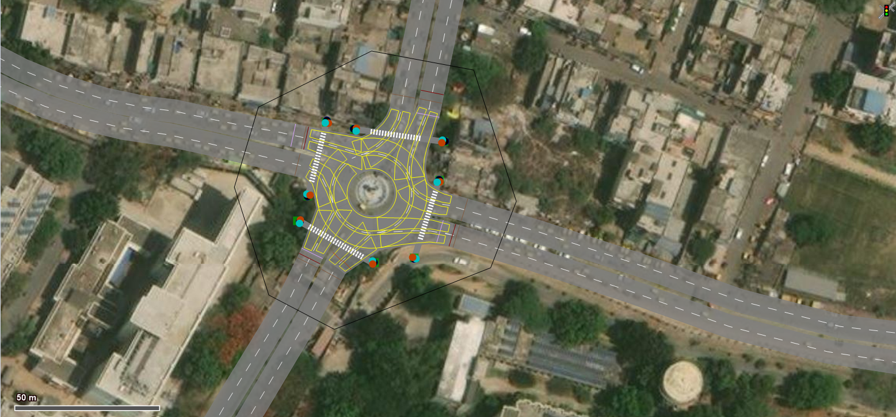
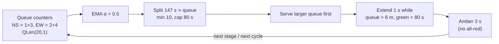
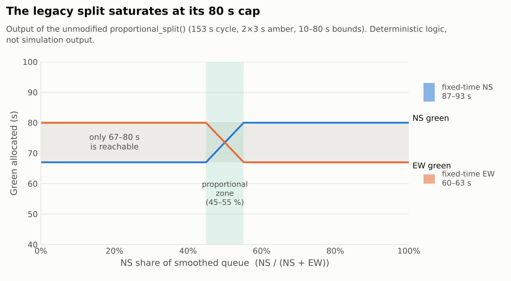
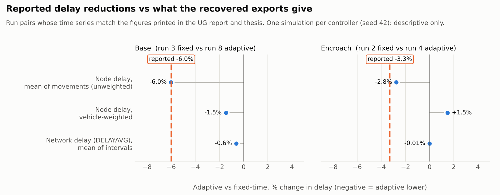
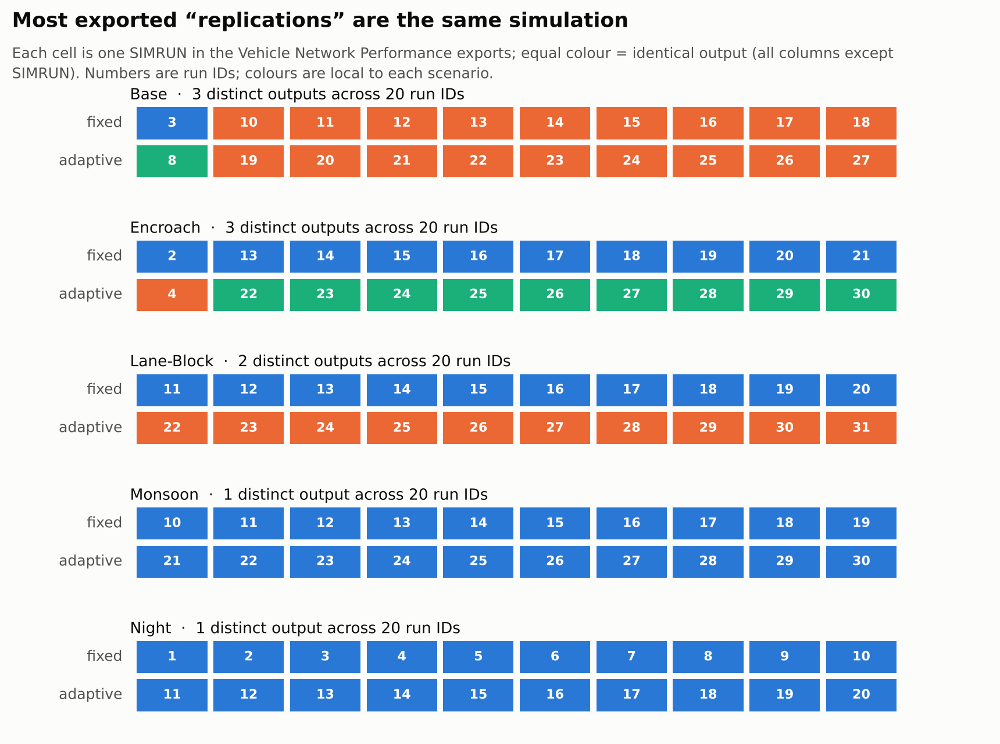
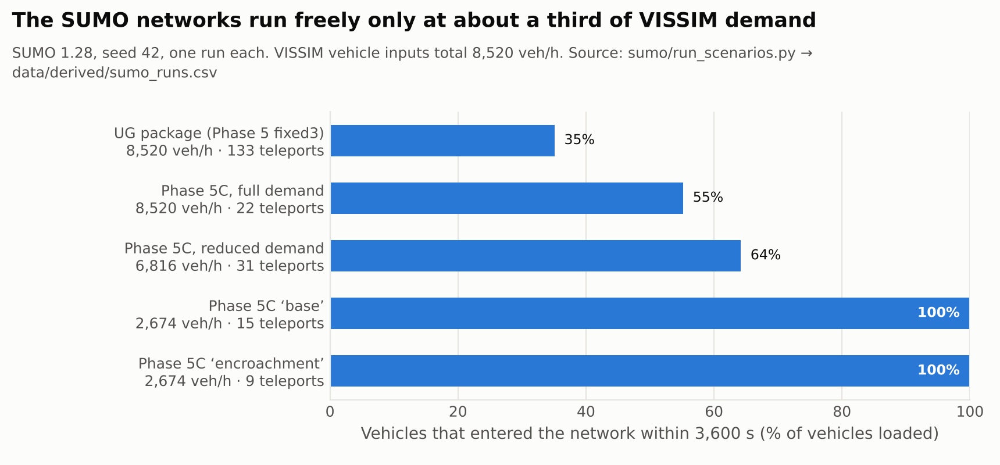
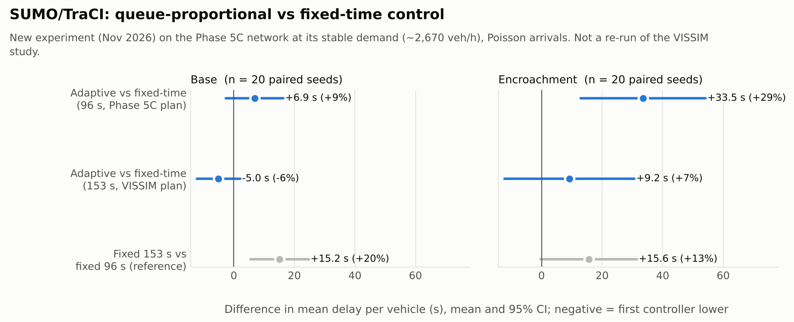

# Adaptive Traffic Signal Control and Open-Source Simulation of Heterogeneous Urban Traffic

**Queue-responsive signal control in PTV VISSIM and an exploratory VISSIM → SUMO migration at Lanka intersection, Varanasi, India**, with a full audit of what the surviving evidence supports.

[](.github/workflows/ci.yml)

 

Indian urban junctions mix motorcycles, auto- and e-rickshaws, cycles, cars, buses and goods vehicles
with weak lane discipline and constant kerbside stopping. Fixed-time plans cannot respond to the queues
this creates. In 2025–26 I built a microsimulation of the Lanka junction near BHU in PTV VISSIM, calibrated by inspection against literature saturation flows,
wrote a queue-proportional adaptive controller that drives it through the COM interface in Python, compared
it with the junction's 153 s fixed-time plan, and began rebuilding the model in the open-source
simulator SUMO.

<p align="center">
  <br>
  <sub>PTV VISSIM model of Lanka intersection (signal-head version). Satellite imagery © Maxar, via the VISSIM background map. Scale bar 50 m.</sub>
</p>

The VISSIM licence has since lapsed. In November 2026 I recovered the original code, models and exports
and audited them. **This repository presents the work together with that audit**: what was built, what
the recovered data actually show, and what can and cannot be claimed.

| Workstream | Status | Re-runnable today? |
|---|---|---|
| Queue-adaptive VISSIM-COM controller | Implemented; original code recovered byte-for-byte | Logic: **yes** (fake-COM replay + 112 tests). Simulation: no (licence) |
| Historical VISSIM evaluation | Reported in UG report (Nov 2025) and thesis (Apr 2026); exports recovered | Reported delay values **not reproducible** from the exports ([why](docs/evidence_audit.md)) |
| VISSIM → SUMO migration | Exploratory; two packages recovered | **Yes**: `python sumo/run_scenarios.py` |
| SUMO/TraCI controller experiment (new, Nov 2026) | Controller ported to SUMO; 160 runs, 20 paired seeds | **Yes**: `python sumo/traci/run_traci_experiment.py` ([results](docs/traci_experiment.md)) |
| Max-Pressure comparison | Unvalidated prototype design | No results exist ([experimental/](experimental/max_pressure)) |

## What was built

* **A mixed-traffic VISSIM model** of the Lanka junction (four approaches, central island, conflict areas,
  Wiedemann 99 driver behaviour, 8,520 veh/h of demand) with five scenarios: base, kerbside encroachment,
  lane blockage, monsoon and night.
* **A closed-loop adaptive controller** in Python that reads VISSIM queue counters over COM, smooths them,
  re-splits green each cycle and extends green while a residual queue remains. It is compared against a
  Webster-derived 153 s fixed-time plan.
* **An open-source SUMO rebuild** of the same junction: hand-repaired topology, eight vehicle classes on the
  sublane model, recreated signals and E2 detectors. It builds and runs with one command.
* **A replicated SUMO/TraCI experiment** (new, November 2026): the controller ported to SUMO with live
  detector queues and tested against fixed-time plans over 20 paired seeds.
* **A reproducible audit** of all of the above. Scripts regenerate every derived table and figure, and
  the 112 tests run without any commercial software.

## Audit findings

1. **The controller's split is narrower than intended.** With a 153 s cycle, 3 s ambers and an 80 s cap, each stage's green can only fall between 67 and 80 s. Allocation is proportional only while the queue split is 45–55 %. Meanwhile the fixed-time baseline gives north–south 87–93 s.
2. **The controller did not read a live queue.** It reads `QLen(20,1)`: time interval 1 of simulation run 20, where queues are evaluated as a single 600–4,200 s interval. That is a stored or cumulative average, not the current queue.
3. **The historical comparison rests on one simulation per controller.** The models use one run with seed 42, so the ten exported "replications" per condition are copies of one or two simulations. The reports' figures match single run pairs: Base 3 vs 8, Encroach 2 vs 4.
4. **The reported 6.0 % and 3.3 % delay reductions cannot be regenerated from the exports.** On the identified run pairs, network delay changes by −0.6 % and −0.01 %; vehicle-weighted node delay by −1.5 % and +1.5 %. Both are single-run differences with no basis for inference.
5. **The model is oversaturated.** In the runs the reports analysed, more than 5,000 vehicles are still waiting to enter the network at the end of evaluation (about 3,900 in the later Base runs). The SUMO rebuild runs freely only at about 31 % of the same demand.

## 1. The controller



<picture>
  <source media="(prefers-color-scheme: dark)" srcset="figures/legacy_allocation_response_dark.png">
  
</picture>

The figure is the output of the archived `proportional_split()` itself, not a re-implementation. The full
audit (12 findings, each pinned by a test) is in [`docs/legacy_code_audit.md`](docs/legacy_code_audit.md).

## 2. Historical results: reported vs recovered

| | Base | Encroachment |
|---|---:|---:|
| **Reported** mean delay, fixed → adaptive (s/veh) | 30.77 → 28.92 (−6.0 %) | 34.77 → 33.62 (−3.3 %) |
| Recovered, network delay `DELAYAVG` (s/veh) | 43.90 → 43.63 (−0.6 %) | 44.38 → 44.38 (−0.01 %) |
| Recovered, node delay, vehicle-weighted (s/veh) | 229.1 → 225.8 (−1.5 %) | 245.4 → 249.0 (+1.5 %) |
| Recovered, vehicles arriving in 600–4,200 s | 3,524 → 3,466 | 3,402 → 3,334 |
| Runs (one each, seed 42) | 3 vs 8 | 2 vs 4 |

<picture>
  <source media="(prefers-color-scheme: dark)" srcset="figures/reproduction_check_dark.png">
  
</picture>

Reported values are kept, with document locations, in
[`data/reported/reported_results.csv`](data/reported/reported_results.csv), each marked *not reproduced*.
The search for their derivation is documented in [`docs/evidence_audit.md §4`](docs/evidence_audit.md#4-attempts-to-reproduce-the-headline-delays).
Some later runs were made on a copy of the model without signal heads. That includes Monsoon, Night and
the second Base batch, so those runs are effectively unsignalised and unusable as results. The runs the
reports compared do behave as signal-controlled ([§6](docs/evidence_audit.md#6-model-versions-signal-heads)).

<picture>
  <source media="(prefers-color-scheme: dark)" srcset="figures/run_identity_dark.png">
  
</picture>

## 3. VISSIM → SUMO migration

The VISSIM network was imported with `netconvert`, then rebuilt by hand as plain-XML nodes, edges and
connections around the central island. Eight vehicle types run on SUMO's sublane model (0.2–0.4 m
lateral resolution) with class-specific lateral aggressiveness. The two-group signal programme was
recreated, and eight E2 detectors are ready for a TraCI controller.

<picture>
  <source media="(prefers-color-scheme: dark)" srcset="figures/sumo_operating_regimes_dark.png">
  
</picture>

At VISSIM demand the network gridlocks: insertion backlog, jams and, with aggressive sublane settings,
collisions. The stable "base" and "encroachment" scenarios run at about 31 % of that demand. Topology
errors, not behaviour parameters, caused most early gridlock; aggressive lateral parameters traded jams
for collisions. Details: [`docs/sumo_migration.md`](docs/sumo_migration.md).

## 4. New: replicated SUMO/TraCI experiment

To get a genuinely replicated test without a VISSIM licence, the controller was ported to SUMO via TraCI.
The port reproduces the archived split function exactly, but reads queues **live** from E2 detectors.
It was run on the Phase 5C network against fixed-time plans: 2 scenarios × 4 controllers × 20 paired seeds.

<picture>
  <source media="(prefers-color-scheme: dark)" srcset="figures/traci_delay_differences_dark.png">
  
</picture>

The controller **did not reduce delay** in this model:

* At the 153 s VISSIM cycle, base delay changes by −5.0 s (95 % CI −12.2 to +2.1 s), i.e. no significant
  difference.
* At 96 s under encroachment it is significantly *worse*: +33.5 s, CI +12.9 to +54.1 s.

The cause is the 6 m extension threshold. Mixed-traffic queues rarely fall below it, so greens keep
extending and cycles lengthen. The controller does rebalance queues between approaches, and a shorter
fixed cycle beats the 153 s plan by about 15 s per vehicle. These are new SUMO results at about 31 % of
VISSIM demand, not a re-run of the VISSIM study. Full design, statistics and limitations:
[`docs/traci_experiment.md`](docs/traci_experiment.md).

## Repository layout

```text
├── vissim/legacy/          original controller, unmodified (+ SHA-256)
├── src/lanka_signal/       loader for the legacy file, fake VISSIM-COM layer, revised helpers (new, unevaluated)
├── analysis/               audit scripts (raw → data/derived), controller replay, figure generation
├── data/
│   ├── reported/           values as printed in the reports, with locations and reproduction status
│   ├── derived/            tables computed from recovered evidence (checksummed back to raw files)
│   └── raw/                private, git-ignored (see data/raw/README.md)
├── sumo/                   recovered SUMO packages (unmodified) + run_scenarios.py
│   └── traci/              new TraCI experiment runner (controllers in src/lanka_signal/traci_controllers.py)
├── experimental/           unvalidated Max-Pressure framework (no results)
├── figures/                light/dark PNGs, all generated by analysis/make_figures.py
├── docs/                   evidence audit, code audit, reconciliation, methods, SUMO, limitations
└── tests/                  112 tests: legacy behaviour, revised helpers, TraCI controllers, data integrity, SUMO smoke tests
```

## Quick start

```bash
git clone https://github.com/ananya-fml/adaptive-traffic-control-mixed-traffic
cd adaptive-traffic-control-mixed-traffic
pip install -r requirements.txt     # includes eclipse-sumo

python -m pytest                    # 112 tests
python analysis/replay_legacy_controller.py
python sumo/run_scenarios.py        # ~4 min
python sumo/traci/run_traci_experiment.py   # ~25 min; --seeds 2 for a quick check
python analysis/make_figures.py
```

Regenerating `data/derived/` from the VISSIM exports requires the private archives (`make audit`).

## Documentation

| Document | Question it answers |
|---|---|
| [Evidence audit](docs/evidence_audit.md) | What do the recovered exports support? |
| [Legacy code audit](docs/legacy_code_audit.md) | What does the controller actually do? |
| [Report reconciliation](docs/thesis_reconciliation.md) | Which statements in the reports hold up? (19 items) |
| [Methods](docs/methodology.md) | Site, model, fixed-time baseline (Webster), scenarios, adaptive controller, measures |
| [SUMO migration](docs/sumo_migration.md) | How the SUMO model was built, what runs, lessons |
| [TraCI experiment](docs/traci_experiment.md) | Does the controller help in a replicated SUMO test? |
| [Limitations & reproducibility](docs/limitations_and_reproducibility.md) | What can be re-run, and what is missing |

## Open research questions

* Does queue-responsive control help at all when the junction is oversaturated and the binding
  constraint is exit and storage capacity? Spillback-aware rules such as Max-Pressure address exactly this.
* How should "queue" be measured in weak-lane-discipline traffic, where a two-wheeler filters past the
  queue it is counted in?
* Can a SUMO sublane model be calibrated to reproduce VISSIM, or field, discharge rates for Indian mixed
  traffic well enough to support controller comparisons?

## Data and model availability

The PTV VISSIM models and raw exports are not yet published here, pending confirmation of redistribution
permission (the models were built under a student licence). The UG report and thesis are institutional
documents. All are available to reviewers on request. Every derived table is regenerated by a script in
`analysis/` from raw files whose SHA-256 checksums are listed in `data/derived/raw_manifest.csv`. The
network screenshot above is the only VISSIM image included.

## Citation and acknowledgements

See [`CITATION.cff`](CITATION.cff). The work was supervised by **Dr. Abhisek Mudgal** (Assistant
Professor, Department of Civil Engineering, IIT (BHU) Varanasi). Thanks to the colleagues acknowledged
in the reports for help with fieldwork and modelling. The 2026 recovery and audit were carried out with
AI assistance; every figure and number is regenerated by the scripts in this repository.

Code: MIT. Documentation, figures, data tables and SUMO files: CC BY 4.0 ([details](LICENSE-docs.md)).
