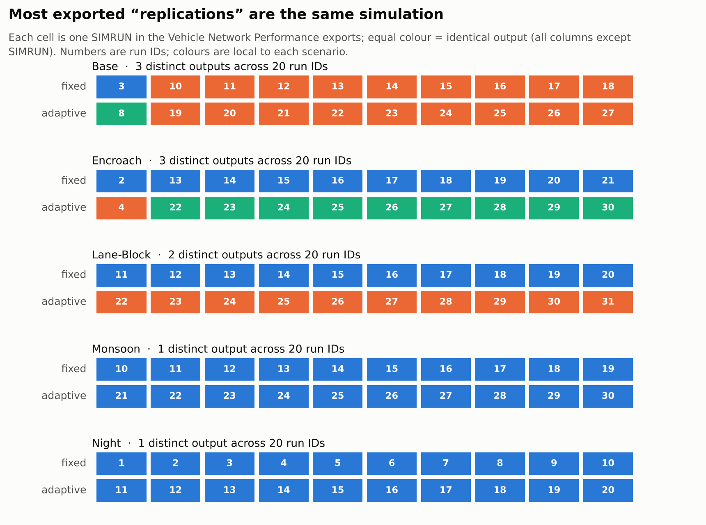
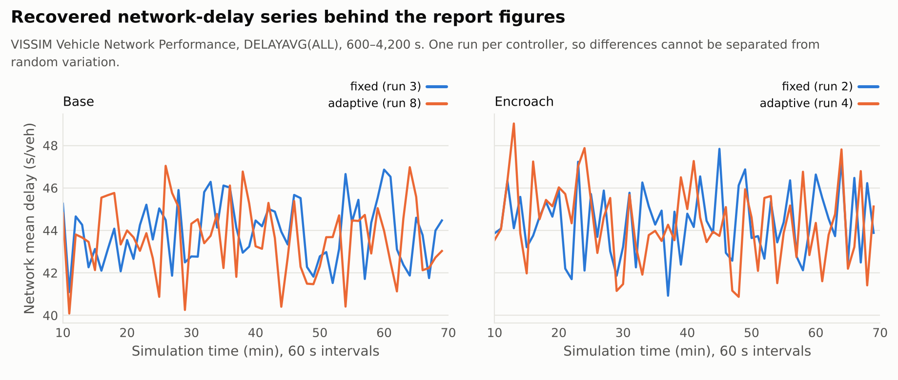
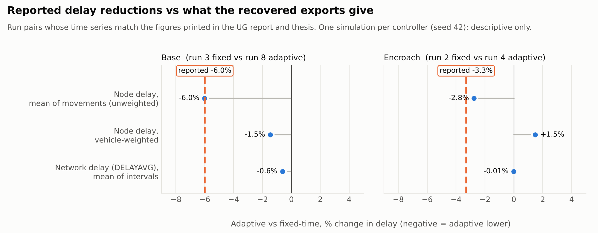

# Evidence audit: what the recovered VISSIM exports do and do not support

*Audit performed November 2026 without a VISSIM licence. Every number below is regenerated by
`analysis/audit_exports.py` and `analysis/audit_inpx.py` from the private archives listed in §1;
the derived tables are in [`data/derived/`](../data/derived).*

## Summary

| Question | Answer from the evidence |
|---|---|
| Can the reported mean delays (30.77 / 28.92 / 34.77 / 33.62 s/veh) be regenerated? | **No.** No column, run or aggregation in the exports produces them (§4). |
| How many independent replications exist per controller and scenario? | **One or two distinct simulations**, not 10. The exported "runs" repeat seed 42 (§2). |
| Which runs did the reports analyse? | The report time-series figures match **Base run 3 vs 8** and **Encroach run 2 vs 4** exactly (§3). |
| Did the adaptive controller change the outcome? | In the report pairs: network delay −0.6 % (Base) and −0.01 % (Encroach); vehicle-weighted node delay −1.5 % and **+1.5 %**. Single runs, so nothing is statistically distinguishable (§5). |
| Monsoon, night, lane-block? | Monsoon and Night "adaptive" exports are copies of fixed-time exports. Lane-Block has one distinct run per controller (§2, §5). |
| Which model version is the intended one? | The **signal-head versions** (in `ug_results.zip`), confirmed by the author. The author believes some runs were made on the copy without signal heads, and the exports bear this out: the Base later batch, Monsoon and Night behave like an unsignalised junction. The runs the reports analysed look signal-controlled (§6). |

## 1. Sources

| Archive | Contents | Notes |
|---|---|---|
| `results.zip` (recovered from chat history) | 5 scenario folders × {fixed, adaptive} × {Node Results, Vehicle Network Performance, Data Collection} CSV; 5 `.inpx`; `ug final final.py` | `.py` is byte-identical to `vissim/legacy/original_legacy_controller.py` (SHA-256 `a96a0dce…`) |
| `ug_results.zip` (supplied 4 Nov 2026) | Same 30 CSVs (**byte-identical** to `results.zip`), same `.py`, 5 `.inpx` | Base, Lane_Block, Monsoon and Night `.inpx` differ from `results.zip` (§6) |
| UG report (submitted 18 Nov 2025) and thesis (submitted 29 Apr 2026) | Reported values, figures | Both print the same headline values and the same figures |

File checksums are in [`data/derived/raw_manifest.csv`](../data/derived/raw_manifest.csv) and
[`data/derived/inpx_settings.csv`](../data/derived/inpx_settings.csv). Zip entry timestamps for the CSVs are
31 Jan 2026, after the UG report. The UG report's figures nevertheless match runs 3/8 and 2/4, so those runs
predate the report and the timestamps reflect a later re-export. All models use `keepPrevResults="KEEPALL"`, so
later runs were appended to the same result files.

## 2. Run structure: replications are repeats of one simulation

Every model file has `numRuns="1"`, `randSeed="42"`, `randSeedIncr="1"`. The legacy controller also forces
`RandSeed = 42`. Launching a single run again therefore reproduces the same simulation under a new `SIMRUN`
number. Hashing each run's rows (all columns except `SIMRUN`) confirms this
([`run_identity.csv`](../data/derived/run_identity.csv)):

| Scenario | Fixed-time folder: distinct outputs (runs) | Adaptive folder: distinct outputs (runs) |
|---|---|---|
| Base | S1 (3) · **S2 (10–18)** | S3 (8) · **S2 (19–27)**, identical to fixed S2 |
| Encroach | S1 (2, 13–21) | S2 (4) · S3 (22–30) |
| Lane_Block | S1 (11–20) | S2 (22–31) |
| Monsoon | S1 (10–19) | **S1 (21–30)**, identical to fixed |
| Night | S1 (1–10) | **S1 (11–20)**, identical to fixed |

Consequences:

* The thesis statement "up to 5 seeds … results averaged" and the later reading of "10 runs" are both
  contradicted. Averaging the 10 run IDs simply re-weights one or two simulations.
* For Base, the later adaptive batch equals the later fixed-time batch. For Monsoon and Night, the
  adaptive files (named `… - Copy.csv`) equal the fixed-time files. The most likely explanation is that
  these runs used the model copy without signal heads, where no controller has any effect (§6). Either
  way, there is no adaptive-control evidence for Monsoon and Night, and those fixed-time outputs are
  probably not fixed-time results either.
* Encroach fixed Node Results also contains run 3, which is absent from its other two exports. It is
  identical to runs 2 and 13–21.

## 3. Which runs the reports analysed

The delay time-series figures printed in **both** reports plot 60 network-delay intervals per controller.
Their values match one specific run each:

| Figure | Matches | Check |
|---|---|---|
| "Delay Time-Series – Base Scenario" | fixed = run 3, adaptive = run 8 | first interval 45.26 / 44.81 s; peaks at intervals 51 / 17 |
| "Delay Time-Series – Encroach Scenario" | fixed = run 2 (= 13–21), adaptive = run 4 | adaptive peak 49.03 s at interval 4 |
| "Encroach Scenario – Network Delay over Time" (index 120–239) | same series concatenated after Base (index 0–119) | 4 blocks × 60 intervals: one run per controller |

The historical analysis was therefore a **single-run comparison** per scenario. The later batches
(runs 10–31) were added afterwards and do not change that.

## 4. Attempts to reproduce the headline delays

The reports attribute 30.77 → 28.92 s/veh (Base) and 34.77 → 33.62 s/veh (Encroach) to "VISSIM node-level
delay … aggregated over the stable simulation window (600–4200 s)". Searched without a match (tolerance
±0.01 s):

* every numeric column of all three exports, per run and pooled across runs;
* mean, median, sum/60 and sum/600, with and without filling missing values;
* node total row vs individual movements; all intervals vs dropping the first 1 or 10 intervals.

The only coincidence is in a percentage, not a level. In the report pair for Base, the **unweighted mean
of movement-level node delay** falls by **6.03 %** (241.5 → 227.0 s), close to the reported 6.01 %. The
absolute values are 7.85 times larger, and the same metric gives 2.75 % for Encroach (reported 3.31 %),
so no consistent transformation links them. The original plotting script has not been recovered.

**Status:** the headline values remain *reported*, and they are labelled *not reproduced* everywhere in this
repository ([`data/reported/reported_results.csv`](../data/reported/reported_results.csv)).

## 5. What the recovered exports show (descriptive, single runs)

Adaptive vs fixed-time, % change (negative = adaptive lower). From
[`comparisons.csv`](../data/derived/comparisons.csv):

| Pair | Network delay (DELAYAVG, interval mean) | Node delay, vehicle-weighted | Node delay, movement mean | Vehicles arrived | Latent demand at 4,200 s (fixed → adaptive) |
|---|---:|---:|---:|---:|---|
| Base, run 3 vs 8 (report pair) | −0.6 % | −1.5 % | −6.0 % | −1.6 % | 5,471 → 5,499 veh |
| Encroach, run 2 vs 4 (report pair) | −0.01 % | **+1.5 %** | −2.8 % | −2.0 % | 5,629 → 5,670 veh |
| Encroach, run 2 vs 22 (later batch) | **+2.8 %** | −11.4 % | −8.0 % | **−8.3 %** | 5,629 → 5,864 veh |
| Lane_Block, run 11 vs 22 | −0.5 % | +0.4 % | −5.0 % | +4.0 % | 5,367 → 5,258 veh |
| Base, Monsoon, Night later batches | 0 (identical outputs) | 0 | 0 | 0 | identical |

Reading these numbers correctly:

1. **n = 1 per arm.** With one seed per controller, differences of a few per cent cannot be separated from
   stochastic variation. No significance test or confidence interval is possible.
2. **The model is heavily oversaturated.** VISSIM inputs total 8,520 veh/h, but only about 3,100–4,900
   vehicles reach their destination in the hour. In the report runs more than 5,000 vehicles (about 3,900 in
   the later Base and Monsoon runs) are still waiting to *enter* the network at 4,200 s (`DEMANDLATENT`). Per-vehicle delay of vehicles that got through excludes this queue.
3. **Per-vehicle delay must be read alongside throughput.** In Encroach run 22 the node delay falls 11 % while
   8 % fewer vehicles arrive and latent demand rises. That is not an unambiguous improvement.
4. Outside the Night scenario, node delay values (≈ 140–250 s/veh) and network delay values (≈ 36–46 s/veh) differ because they measure
   different populations and segments. Neither equals the reported 30–35 s/veh.

## 6. Model versions: signal heads

| Scenario | `results.zip` `.inpx` | `ug_results.zip` `.inpx` |
|---|---|---|
| Base | VISSIM 2025.00-11, **0 signal heads** | VISSIM 2025.00-06, 8 signal heads |
| Encroach | 2025.00-11, 8 heads | identical file |
| Lane_Block | 2025.00-11, **0 heads** | 2025.00-06, 8 heads |
| Monsoon | 2025.00-11, **0 heads** | 2025.00-06, 8 heads |
| Night | 2025.00-11, **0 heads** | 2025.00-06, 8 heads |

In VISSIM, signal groups only affect traffic through signal heads. A model with no signal heads is
unsignalised, whatever the controller does. A tag-by-tag comparison shows the two versions differ only in the
signal heads, the build number, and one build-related evaluation tag (`<managedLanes>`). Where present, the eight heads map
SG1 to links 4 and 8 (East and West) and SG2 to links 2 and 6 (North and South), consistent with the
controller's stage definitions.

**The author has confirmed that the `ug_results.zip` versions, with eight signal heads, are the intended
models** for all five scenarios. They are the reference for this repository. The run logs do not record
which copy each export came from, so one alternative explanation for §2's identical Base batches remains
open: they may have been produced by the copy without signal heads, which makes the controller
irrelevant.

### Author's account (6 Nov 2026) and what the exports show

The author recalls the following:

* Fixed-time runs were made from the VISSIM GUI and adaptive runs through the Python script.
* Both controllers were run for all five scenarios.
* Some runs were probably made on the model copy without signal heads.
* Seeds were not varied between runs.
* The script that computed the headline values is not known.

The exports support this, and narrow down which runs were affected. At the same demand (8,520 veh/h),
the distinct simulations fall into two separate groups
([`distinct_simulations.csv`](../data/derived/distinct_simulations.csv)):

| Group | Simulations | Vehicles arrived | Latent demand at 4,200 s | Node delay (s/veh) | Fixed vs adaptive |
|---|---|---:|---:|---:|---|
| A: behaves as **unsignalised** | Base runs 10–27; Monsoon (all) | 4,856–4,895 | ≈ 3,900 | 140–145 | identical |
| B: behaves as **signal-controlled** | Base runs 3 and 8; Encroach (all); Lane_Block (all) | 3,120–3,632 | 5,258–5,864 | 217–249 | different |

Group A delivers about 40 % more vehicles than the signal-controlled Base runs (4,856 vs 3,466–3,524) with lower
delay, despite Monsoon's reduced speeds, and the controller has no effect on it. That is what removing signal control from an oversaturated junction would do. Night
(3,651 veh/h) cannot be placed by throughput, but its fixed and adaptive outputs are identical, which
fits Group A.

This is an inference from outputs, not a record. It means:

* the comparisons the reports used (Base 3 vs 8, Encroach 2 vs 4) and Lane_Block are **genuine
  signal-controlled comparisons**, still with one run per arm;
* the Base later batch, Monsoon and Night results are **not usable as either fixed-time or adaptive
  results**.

On seeds: a seed increment alone would not have helped. Each VISSIM launch was a single run starting
from the model's seed 42, and the script also sets `RandSeed = 42`. The seed has to be changed for each
launch (see [limitations](limitations_and_reproducibility.md)).

On `SIMULATION_NO`: the author recalls it updating automatically, but the archived script hard-codes
`SIMULATION_NO = 20`. The run used for queue reading would only have followed the current run if the
line was edited, or if a different version of the script was used. Either way, the queue input
remained a single-interval evaluation result (L1 in the
[code audit](legacy_code_audit.md#2-findings)).

## 7. Settings confirmed from the models

| Setting | Value | Source |
|---|---|---|
| Simulation period / resolution | 4,500 s; 10 steps/s (**15** for Lane_Block) | `<simulation>` |
| Seed | 42, increment 1, `numRuns=1` | `<simulation>` |
| Node, network, data-collection evaluation | 600–4,200 s, 60 s intervals | `<evaluation>` |
| Queue-counter evaluation | 600–4,200 s, **one interval** (`interval=99999`) | `<queues>` |
| Queue counters | 1 North (link 2), 2 East (link 4), 3 South (link 6), 4 West (link 8) at ≈200 m; Lane_Block moves 1 and 4 to links 40 and 35 | `<queueCounter>` |
| Signal controller | `FIXEDTIME`, 153 s programme, intergreens 0 s | `<signalController>` |
| Vehicle inputs | 8,520 veh/h (Night 3,651 veh/h) | `<vehicleInput>` |

The single queue-evaluation interval matters for the controller. `QLen(run, 1)` refers to interval 1 of
that run, here the whole 600–4,200 s window. During a run, VISSIM can at best expose a cumulative average
since 600 s for it, never the current queue. See [legacy_code_audit.md](legacy_code_audit.md).

## 8. What this means for any public claim

Supportable:

* A queue-proportional adaptive controller was designed, implemented in Python over VISSIM COM, and run
  against a calibrated-by-inspection mixed-traffic model of Lanka. The code survives unchanged.
* Single-run comparisons were made for base and encroached conditions, and later attempted for lane-block.
* The reports' qualitative observations about oversaturation and encroachment effects are consistent with
  the exports.

Not supportable from the surviving evidence:

* that the controller reduced delay by 6.0 % or 3.3 %, or reduced emissions by 1.5–1.9 %;
* any statement of robustness across seeds, or of statistical significance;
* any monsoon or night result, fixed-time or adaptive (probably unsignalised runs);
* that the adaptive controller was actually controlling the signals in every exported run.

## 9. What would resolve the open questions

1. The original analysis notebook or script that produced 30.77/28.92/34.77/33.62.
2. The VISSIM `.err`/`.att` files or a log confirming that the signal-head models and the intended `SIMULATION_NO` were used for runs 3, 8, 2 and 4.
3. A licensed re-run: the signal-head version of each model, seed increment > 0, ≥ 10 seeds per arm,
   controller verified to be writing `SigState` (e.g. via the Signal Times Table).
