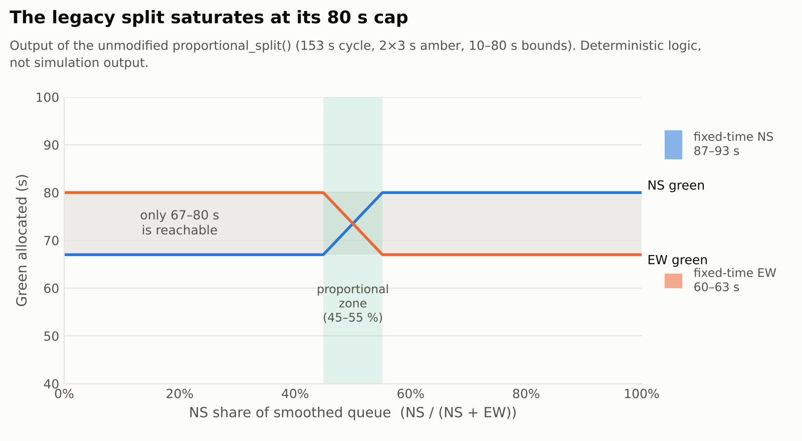

# Audit of the legacy VISSIM-COM controller

File: [`vissim/legacy/original_legacy_controller.py`](../vissim/legacy/original_legacy_controller.py)
(9,071 bytes, SHA-256 `a96a0dcea97e882ac83439d9313a21ae78cab2a51a0e6faf6fe725f419890a96`). It is
byte-identical to `ug final final.py` in both recovered result archives, and it is **never edited**.

Every behavioural statement below is checked by a test in
[`tests/test_legacy_logic.py`](../tests/test_legacy_logic.py). The tests execute the unmodified file: the
`win32com` import is satisfied by a stand-in module, and `main()` is replayed against a fake VISSIM
object ([`src/lanka_signal/fake_vissim.py`](../src/lanka_signal/fake_vissim.py)) that returns chosen
queue values. That replay exercises the *control logic only*; it simulates no traffic.

## 1. What the algorithm is

```text
warm-up 600 s (signals left as the model's own controller has them)
repeat 23 times  (⌊(4500 − 600 − 300) / 153⌋):
    q_s   ← Σ QueueCounter.AttValue("QLen(20,1)")   for counters of stage s   (NS: 1+3, EW: 2+4)
    q̃_s   ← 0.5·q_s + 0.5·q̃_s                        (EMA, q̃ initialised to 0)
    g_s   ← 10 + (147 − 2·10) · q̃_s / Σ q̃            (147 = 153 − 2×3 s amber)
    cap g_s at 80, give the overflow to the other stage
    serve stages in descending q̃ order:
        all signal groups RED → stage GREEN
        every 1 s: re-read q_s; once g_s has elapsed, extend 1 s while q_s > 6 m and g_s < 80
        stage AMBER for 3 s
all-red for the 81 s remainder, all-red 300 s cool-down, Simulation.Stop()
```

It is a **cycle-level, queue-proportional split with a residual-queue extension**. It is not
Max-Pressure: downstream conditions are never read. It is also not the actuated
"extend while queue > threshold, otherwise terminate" logic drawn in the thesis flowchart; there is no
early termination.

## 2. Findings

| # | Finding | Type | Evidence |
|---|---|---|---|
| L1 | **Queue input is not instantaneous.** `QLen(20,1)` always reads run 20, time interval 1. The models evaluate queues in a single 600–4,200 s interval, so this is at best a cumulative average since 600 s, and reads a different run's stored result whenever the current run is not number 20. | Confirmed from code + `.inpx` | `test_replay_reads_fixed_run_and_interval_index`; [evidence_audit §7](evidence_audit.md#7-settings-confirmed-from-the-models) |
| L2 | **The split can only move between 67 and 80 s.** With two stages, 147 s of green and an 80 s cap, the other stage always gets ≥ 67 s. Allocation is proportional only while the NS queue share is 45–55 %; outside that it is a fixed 80/67 or 67/80. | Confirmed | `test_split_always_uses_full_budget_and_stays_in_67_80`, `test_split_is_proportional_only_between_45_and_55_percent`; figure below |
| L3 | **The NS stage can never get the green the fixed-time plan gives it.** The archived fixed-time programme gives NS ≈ 87–93 s (§4); the adaptive cap is 80 s. | Confirmed | §4 |
| L4 | **Zero queues collapse the cycle to 26 s.** If every reading is 0, both stages get 10 s. Over 23 such cycles the script reaches its cool-down and calls `Simulation.Stop()` at about 1,579 s, well before the 4,200 s end of evaluation. | Confirmed (logic) | `test_zero_queues_collapse_cycle_to_minimum_greens`, `test_replay_zero_queue_ends_run_early` |
| L5 | **A missing reading crashes the run.** `read_queue_m` returns `None` when `QLen` has no value; summing it raises `TypeError`. | Confirmed (logic) | `test_read_queue_returns_none_for_missing_value`, `test_replay_none_queue_crashes` |
| L6 | **Cycles drift beyond 153 s.** Greens are served in whole 1 s steps (a 73.5 s target runs 74 s), and the tail extension adds up to 80 s. With a constant reading above 6 m every green runs to 80 s, giving 166 s cycles, and the script runs 299 s past `SimPeriod`. | Confirmed (logic) | `test_replay_constant_queue_above_threshold_extends_to_max_green`, `test_replay_balanced_small_queue_rounds_green_up_by_stepping`; [`legacy_replay.csv`](../data/derived/legacy_replay.csv) |
| L7 | **81 s of forced all-red inside the evaluation window.** The planned 23 × 153 s ends at 4,119 s; the script then holds all-red until 4,200 s and for the 300 s cool-down. The fixed-time runs keep cycling. | Confirmed (logic) | `test_cycle_plan_leaves_81s_remainder` |
| L8 | **No clearance between conflicting stages.** `ALL_RED = 0`; the next stage turns green the instant the previous amber ends. This matches the model's 0 s intergreen matrix, but contradicts "intergreen times set per IRC guidelines" in the reports. | Confirmed | `test_no_all_red_between_conflicting_greens` |
| L9 | **Same stage can be served twice in a row.** Stage order is re-sorted every cycle, so the last stage of one cycle can be the first of the next, producing green → amber → green on the same approach. | Confirmed from code | code lines 185–218 |
| L10 | **Whether `SigState` writes took effect is unknown.** The model's controller is `FIXEDTIME`. Depending on VISSIM version and controller type, overriding a signal group over COM may require explicitly handing it to COM control (e.g. the `ContrByCOM` attribute), which the script never sets. This needs checking in VISSIM. | Needs VISSIM | Base later batch: adaptive output identical to fixed-time ([evidence_audit §2](evidence_audit.md#2-run-structure-replications-are-repeats-of-one-simulation)) |
| L11 | **Seed hard-coded to 42**, with one run per launch, so repeated runs are identical. | Confirmed | [evidence_audit §2](evidence_audit.md#2-run-structure-replications-are-repeats-of-one-simulation) |
| L12 | Comments and constants disagree: the header says `QLen(11,1)` (the thesis shows the same), the constant is 20, and its comment says "change to the current sim no.". | Confirmed | lines 4, 59 |



## 3. What can and cannot be concluded

L1–L9 are properties of the code, demonstrated without VISSIM. Their *effect on the archived runs*
depends on what `QLen(20,1)` actually returned during those runs, and on whether signal writes were
honoured (L10). Neither can be established now. The replay cases
([`legacy_replay.csv`](../data/derived/legacy_replay.csv)) bracket the possibilities:

| `QLen` returns | Greens (EW / NS) | Cycle | Script ends |
|---|---|---|---|
| constant 12 m (above threshold) | 80 / 80 s | 166 s | 4,799 s (299 s past SimPeriod) |
| constant 3 m (below threshold) | 74 / 74 s | 154 s | 4,523 s |
| NS 10 m, EW 2 m per counter, constant | 67 / 80 s | 153 s | 4,500 s |
| 0 | 10 / 10 s | 26 s | 1,579 s |
| `None` | crashes with `TypeError` | – | – |

Every archived export has 60 complete intervals. If the script was driving those runs, the 0 and `None` cases did not persist throughout, because the script would have stopped or crashed the run.

## 4. Fixed-time reference programme

Decoded from the model's embedded signal programme ([`fixed_time_programme.csv`](../data/derived/fixed_time_programme.csv)),
identical in all five scenarios. Cycle 153 s, intergreens 0 s:

| Signal group | Commands | Amber | Green duration |
|---|---|---|---|
| SG1 (East–West) | GREEN at 0 s, RED at 63 s | 3 s fixed | **60 s or 63 s** |
| SG2 (North–South) | RED at 3 s, GREEN at 63 s | 3 s fixed | **87–93 s** |

The range reflects where VISSIM places the fixed amber relative to the RED command, which cannot be
confirmed without the software's signal-times table. The SUMO reconstruction assumed EW 60 + 3 s and
NS 87 + 3 s. Under one reading (amber after the RED command) the two greens would overlap for 3 s; the
SUMO interpretation avoids this. Either way, the fixed-time plan is strongly NS-biased, and the adaptive
controller's 67–80 s band forces a *more balanced* split than the baseline it was compared against.

## 5. Revised helpers (new code, not evaluated)

[`src/lanka_signal/revised_logic.py`](../src/lanka_signal/revised_logic.py) fixes L2's budget handling
for any number of stages, L4, L5 and L6's rounding, and exposes `effective_green_range()`. It is written
for future work. It was **never run in a simulator** and produced none of the results discussed anywhere
in this repository.
