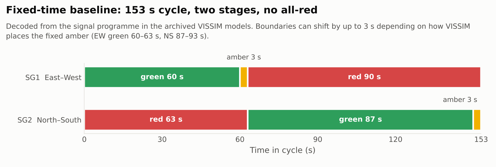
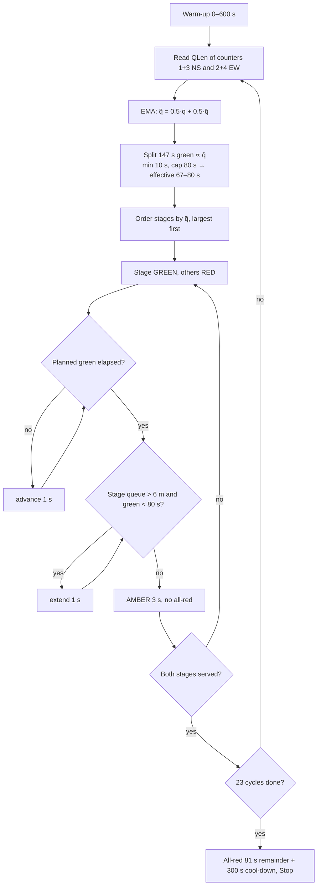

# Study design and methods

## Site

Lanka intersection, Varanasi (Uttar Pradesh, India), near Banaras Hindu University: a signalised
four-arm junction with a central island and internal circulation. The model names its approaches North,
East, South and West; the reports also refer to the BHU and Bhagwanpur approaches. Traffic is heterogeneous,
with motorised two-wheelers, auto-rickshaws, e-rickshaws, cycles, cars, light commercial vehicles,
buses and emergency vehicles, weak lane discipline and frequent kerbside stopping.

## VISSIM model (PTV VISSIM 2025, student licence)

* Geometry from field measurements of approach widths, link lengths and stop lines, plus satellite
  imagery; links, connectors, conflict areas, reduced-speed areas and priority rules.
* Demand: four vehicle inputs totalling 8,520 veh/h (Night 3,651 veh/h) from short manual counts;
  static routing decisions for turning movements.
* Behaviour: Wiedemann 99 car-following; CC0/CC1 and safety-distance parameters adjusted by trial runs.
  Calibration was visual and against literature saturation flows, not against field queue or delay data.
* Control: one `FIXEDTIME` controller, two signal groups (SG1 East–West, SG2 North–South), 153 s cycle,
  3 s amber, 0 s intergreen ([legacy_code_audit §4](legacy_code_audit.md#4-fixed-time-reference-programme)).
* Measurement: four queue counters (one per approach, ≈ 200 m from link start); Node Results, Vehicle
  Network Performance and Data Collection at 60 s intervals over 600–4,200 s.

## Fixed-time baseline controller

The baseline is a pre-timed, two-stage plan that repeats the same timings every cycle regardless of
traffic. East–West (SG1) and North–South (SG2) are served in turn, each followed by a 3 s amber, with no
all-red.

<picture>
  <source media="(prefers-color-scheme: dark)" srcset="../figures/fixed_time_timing_dark.png">
  
</picture>

### How it was set: Webster's method

The cycle length and green split were calculated with Webster's method from the junction's traffic inputs:

1. Flow ratio of each stage's critical movement:

   $$y_i = \frac{q_i}{s_i}$$

   where $q_i$ is the critical approach flow (veh/h or PCU/h) and $s_i$ its saturation flow.

2. Sum over the stages:

   $$Y = \sum_i y_i$$

3. Optimum cycle length:

   $$C_0 = \frac{1.5\,L + 5}{1 - Y}$$

   where $L$ is the total lost time per cycle (s).

4. Effective green for each stage, in proportion to its flow ratio:

   $$g_i = (C_0 - L)\,\frac{y_i}{Y}$$

The individual input values ($q_i$, $s_i$, $L$) were not preserved with the project files. The adopted
plan is: cycle $C = 153$ s; EW green ≈ 60 s; NS green ≈ 87 s; amber 3 s per stage.

### What the adopted plan implies

Taking lost time as the two 3 s ambers ($L = 6$ s, all-red 0 s), the formulas can be run backwards:

* Cycle: $153 = (1.5 \times 6 + 5)/(1 - Y)$ gives $Y \approx 0.91$.

  The junction's critical flow ratio is close to 1, i.e. near saturation. That is consistent with the large
  queues in the simulation outputs. Near $Y = 0.9$, Webster's formula is very sensitive: $Y = 0.88$ gives
  117 s, while $Y = 0.93$ gives 200 s. Practitioners often cap the cycle at around 120–150 s for this reason.

* Split: $g_{NS}/g_{EW} \approx 87/60 \approx 1.45$, so $y_{NS} \approx 1.45\,y_{EW}$.

  Combined with $Y \approx 0.91$, this gives $y_{NS} \approx 0.54$ and $y_{EW} \approx 0.37$. North–South
  was treated as clearly the more critical direction.

These are back-calculations from the plan, not the original inputs.

### Relation to the adaptive controller

The adaptive controller keeps the same 153 s cycle and 3 s ambers but re-splits the green each cycle. Its
80 s cap means it can never give North–South the ~87 s that Webster's split gives. Under steady NS-heavy
demand it therefore allocates *less* NS green than the baseline it is compared with
([legacy_code_audit L3](legacy_code_audit.md#2-findings)).

## Scenarios

| Scenario | Definition (thesis) | Model file | Adaptive evidence |
|---|---|---|---|
| Base | Lane-disciplined, no kerbside stopping | `Lanka_Original_Calibrated.inpx` | single run (run 8) |
| Encroachment | ≈ 20 % of two-wheelers and autos make short kerbside stops; reduced effective width; reduced-speed area | `Lanka_S1_Encroach.inpx` | single run (run 4), plus a later single run (22) |
| Lane-block | One entry lane blocked on the BHU and on the Bhagwanpur approach, one exit lane on Bhagwanpur | `Lanka_S2_Lane_Block.inpx` | single run (22) |
| Monsoon | Lower desired speeds and acceleration; larger CC1/CC2; larger accepted gaps | `Lanka_S3_Monsoon.inpx` | **none** (runs likely made without signal heads) |
| Night | Demand 3,651 veh/h, more cars/2W, higher speeds, smaller CC1 | `Lanka_S4_Night.inpx` | **none** (runs likely made without signal heads) |

## Controller (as implemented)

The queue input `QLen(20,1)` is an evaluation-interval result, not a live reading. See
[legacy_code_audit.md](legacy_code_audit.md) for what this implies.

## Performance measures (as planned in the reports)

Average delay (s/veh), queue length, stops, speed and headway variability, CO/NOx/VOC and fuel
consumption. In the exported VISSIM node results, the emission columns are proportional to fuel
consumption, so they carry one piece of information.

## Analysis in this repository

* **Reported values** are transcribed with document locations in
  [`data/reported/reported_results.csv`](../data/reported/reported_results.csv) and are never mixed with
  recomputed values.
* **Recovered exports** are summarised per *distinct* simulation (identical runs collapsed) by
  `analysis/audit_exports.py`. Comparisons are descriptive, one run per arm; no inferential statistics
  are computed because none are valid with n = 1.
* **Controller logic** is examined by executing the unmodified legacy file against a fake COM layer
  (`analysis/replay_legacy_controller.py`).
* **SUMO** packages are rebuilt and run unmodified by `sumo/run_scenarios.py`.
