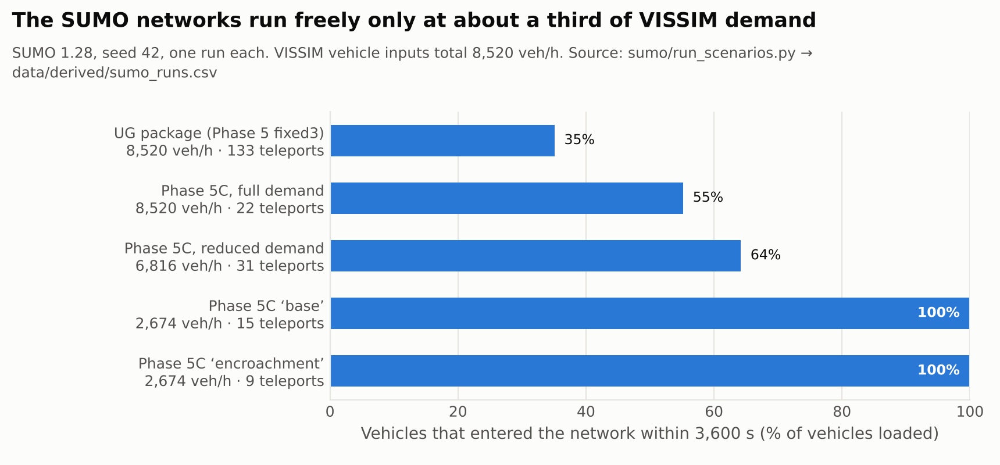

# Exploratory VISSIM → SUMO migration

**Status: exploratory.** The recovered SUMO packages build and run on SUMO 1.28.0. They are not
calibrated against VISSIM, no TraCI script survives from the original work, and they are
stable only at reduced demand. A TraCI controller was added in November 2026 ([traci_experiment.md](traci_experiment.md)). Nothing here is evidence about controller performance.

## 1. Why migrate

The VISSIM study depends on a commercial licence (the model was built under a student licence) and
cannot be re-run today. A working open-source model is the only licence-free route to the experiment
the original study needed: many seeds, paired controllers and a verified controller in the loop.

## 2. Workflow as carried out (from the thesis, cross-checked with the files)

1. **Import.** `netconvert --vissim-file <model>.inpx`. This produced self-looped and disconnected
   connectors, invalid turns and overlapping internal links around the central island.
2. **Rebuild the topology by hand.** The recovered packages contain hand-written plain-XML networks
   (`.nod/.edg/.con`), not the raw import. Edges `v2/v4/v6/v8` are the N/E/S/W approaches; the ring and
   exits are separate edges. The UG package README records the key fix: connections must join edges
   at a *shared* node.
3. **Signals.** Four static `tlLogic` nodes (one per approach entry) imitate the VISSIM two-group
   programme. The UG package uses 153 s (EW 60 + 3, NS 87 + 3); Phase 5C shortens this to 96 s
   (EW 40 + 3, NS 50 + 3).
4. **Demand.** 92 `flow` elements reproduce the VISSIM inputs (8,520 veh/h in total) by approach,
   turning movement and vehicle class.
5. **Heterogeneous traffic.** Eight `vType`s (motorbike, cycle, auto, e-rickshaw, car, LCV, bus,
   ambulance) with the sublane model (`lateral-resolution` 0.2–0.4 m) and class-specific
   lane-changing parameters (`lcSublane`, `lcPushy`, `lcImpatience`, `lcAssertive`, `minGapLat`).
   No `carFollowModel` is set, so SUMO's default Krauss model applies.
6. **Detectors.** Eight E2 lane-area detectors (two lanes × four approaches), writing 1 s output for a
   future queue controller.
7. **Anti-gridlock iterations.** Phase 5C enlarged the inner ring and exit connectors and raised
   lane-changing aggressiveness. Later patches reduced demand by approach (30 % N/S, 55 % E/W in
   "stable_safe" / "base") and *lowered* aggressiveness again to stop collisions.

## 3. What actually runs

`python sumo/run_scenarios.py` (seed 42, 3,600 s, one run each), recorded in
[`data/derived/sumo_runs.csv`](../data/derived/sumo_runs.csv):

| Run | Demand (veh/h) | Entered / loaded | Still waiting to enter at 3,600 s | Teleports | Mean time loss (s) |
|---|---:|---:|---:|---:|---:|
| UG package (Phase 5 fixed3), as delivered | 8,520 | 3,006 / 8,552 (35 %) | 5,546 | 133 | 677 |
| Phase 5C, full demand | 8,520 | 4,720 / 8,552 (55 %) | 3,832 | 22 | 537 |
| Phase 5C, reduced demand | 6,816 | 4,406 / 6,860 (64 %) | 2,454 | 31 | 396 |
| Phase 5C "base" | 2,674 | 2,722 / 2,724 (100 %) | 2 | 15 | 73 |
| Phase 5C "encroachment" | 2,674 | 2,726 / 2,728 (100 %) | 2 | 9 | 115 |
| Phase 5C default `.sumocfg`, unmodified | – | fails: `ignore-junction-blocker="true"` is not a number | – | – | – |

All teleports in the Phase 5C runs are collision-triggered. The "full" and "reduced" Phase 5C runs use the
command-line override `--ignore-junction-blocker 5` (the value used in the later configs); the archived files
are untouched.

**Interpretation.** At the VISSIM demand level the SUMO network is gridlocked: most vehicles never
enter. It runs freely only at about 31 % of that demand. The "base vs encroachment" pair is therefore
a comparison at a much lower demand than the VISSIM study used. Its difference (73 → 115 s mean time
loss) is a single-seed observation in an uncalibrated model.

Note that the VISSIM model is also oversaturated at 8,520 veh/h: more than 5,000 vehicles in the report runs are
still waiting to enter at 4,200 s ([evidence_audit §5](evidence_audit.md#5-what-the-recovered-exports-show-descriptive-single-runs)).
The SUMO gridlock is partly a property of the demand, not only of SUMO.

## 4. Vehicle-type parameters: thesis table vs files

The thesis calibration table matches no single recovered file:

| Class | Thesis (lcSublane / lcPushy / lcImpatience / lcAssertive / minGapLat) | Phase 5C *full* file | Phase 5C *base* file |
|---|---|---|---|
| motorbike | 3.0 / 2.0 / 1.5 / 3.0 / 0.05 | **same** | 1.5 / 0.9 / 0.8 / 1.4 / 0.18 |
| auto | 2.5 / 1.5 / 1.2 / 2.5 / 0.10 | 2.5 / 1.5 / 1.2 / 2.5 / 0.08 | 1.3 / 0.65 / 0.6 / 1.3 / 0.22 |
| car | 2.0 / 1.0 / 0.9 / 2.0 / 0.20 | 2.0 / 1.0 / 0.9 / 2.0 / 0.10 | 1.1 / 0.35 / 0.35 / 1.1 / 0.30 |
| bus | 1.0 / 0.6 / 0.5 / 1.0 / 0.50 | 1.2 / 0.6 / 0.5 / 1.4 / 0.15 | 0.6 / 0.10 / 0.15 / 0.8 / 0.50 |

The runnable "base" and "encroachment" scenarios use markedly *less* aggressive lateral behaviour than
the thesis describes. The thesis table is best read as the Phase 5C full-demand intent.

## 5. Recovered packages

| Package | In this repo | State |
|---|---|---|
| `lanka_sumo_UG.zip` | [`sumo/ug_phase5_fixed3/`](../sumo/ug_phase5_fixed3) | Complete incl. compiled net; runs; gridlocks at full demand |
| `lanka_phase5_fixed3_sumo.zip` | not included | Earlier version of the same network: no compiled net, milder lane-changing parameters, differently formatted detector file |
| `lanka_phase5c_exitfix.zip` + `lanka_phase5c_base_encroachment.zip` | [`sumo/phase5c/`](../sumo/phase5c) | Builds with `netconvert`; runs (see §3) |
| `…_approach_reduced`, `…_fixed_routes`, `…_stable_safe` | not included | Route-file variants and a config patch, superseded by base/encroachment |
| `…_exitfix_v2`, `…_final` | not included | Stub files of 14–91 bytes; not a model |
| `lanka_phase6_redesign.zip` | not included | Builds, but fails at run time: `No connection between edge 'v34a' and edge 'v29'` |
| `lanka_e2_output.xml` | not included | Detector output from an unknown configuration |

## 6. Lessons that carry over

* **Topology before behaviour.** Most early gridlock came from connections joining edges at different
  nodes. Lane-changing parameters cannot fix a disconnected graph.
* **Aggressive sublane parameters trade gridlock for collisions.** Raising `lcPushy`/`lcAssertive` and
  lowering `minGapLat` cleared jams but produced collision teleports; the stable configs walked this back.
* **A demand cut is not a calibration.** Stability at 31 % demand makes the network run; it does not make
  it represent Lanka.
* **Fidelity checks need numbers.** "Visual congestion realism" was the only similarity test. The next
  step is a quantitative target: VISSIM fixed-time throughput and queue lengths for the same demand.

## 7. Next steps

1. Calibrate Phase 5C fixed-time throughput against the VISSIM fixed-time export at a common demand
   level, ideally field counts.
2. ~~Port the queue-proportional logic to TraCI~~: done; see [traci_experiment.md](traci_experiment.md).
3. Run ≥ 20 seeds per controller and report paired differences with confidence intervals. Those would be
   new SUMO results, not a replication of the VISSIM study.
