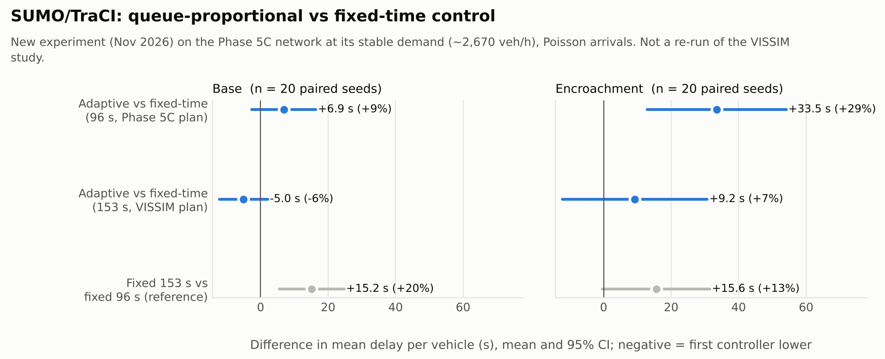

# SUMO/TraCI experiment: queue-proportional vs fixed-time control

**New experiment, November 2026.** It runs a port of the archived controller on the recovered SUMO
Phase 5C network, with replicated, paired random seeds. These are new SUMO results. They are **not** a
re-run of, or a validation for, the 2025 VISSIM study, whose model, demand and calibration differ.

Reproduce: `python sumo/traci/run_traci_experiment.py` (160 runs, ≈ 25 min on 2 cores), then
`python analysis/make_figures.py`. Results: [`traci_runs.csv`](../data/derived/traci_runs.csv),
[`traci_paired.csv`](../data/derived/traci_paired.csv).

## Design

| Item | Choice |
|---|---|
| Network | Phase 5C (archived files, rebuilt with `netconvert`), SUMO 1.28.0 via `libsumo` |
| Scenarios | `base` and `encroachment` routes: ≈ 2,670 veh/h, the demand at which Phase 5C runs stably (≈ 31 % of VISSIM demand) |
| Arrivals | Each flow's regular insertion converted to Poisson arrivals at the same hourly rate, so seeds vary arrivals as well as driver behaviour |
| Seeds | 20 per scenario (1000–1019), identical across controllers, so differences are paired |
| Timing | Demand 0–3,600 s; run continues to 4,500 s so vehicles can clear |
| Evaluation | Vehicles scheduled to depart in 600–3,600 s; delay = SUMO `timeLoss` + `departDelay` (s/veh), unfinished vehicles included |
| Queue input | E2 jam length; approach = max of its two lanes; stage = sum of its two approaches (as VISSIM counters 1+3, 2+4) |
| Statistics | Mean paired difference, 95 % t-interval, paired t-test p-value |

### Controllers ([`traci_controllers.py`](../src/lanka_signal/traci_controllers.py))

| Name | Description |
|---|---|
| `fixed_96` | Archived Phase 5C programme: EW 40 s, NS 50 s, 3 s ambers |
| `fixed_153` | VISSIM programme as read by the SUMO reconstruction: EW 60 s, NS 87 s, 3 s ambers |
| `adaptive_96` | Queue-proportional port, 96 s nominal cycle |
| `adaptive_153` | Queue-proportional port, archived 153 s parameters |

The adaptive port reproduces the archived logic: EMA α = 0.5, 10–80 s bounds with one overflow pass,
largest queue first, 1 s extensions while the stage queue exceeds 6 m, 3 s amber, no all-red. Its split
function is tested to equal the archived `proportional_split()` exactly. Two deliberate differences:

* queues are **live** detector readings instead of `QLen(20,1)`;
* control continues for the whole run, with no all-red remainder or cool-down.

## Results

Mean delay per vehicle (s), mean of 20 seeds:

| Scenario | fixed_96 | adaptive_96 | fixed_153 | adaptive_153 |
|---|---:|---:|---:|---:|
| Base | 76.3 | 83.2 | 91.5 | 86.4 |
| Encroachment | 117.1 | 150.6 | 132.6 | 141.8 |

Paired differences (first minus second controller):

| Scenario | Comparison | Difference (s) | 95 % CI (s) | % | p |
|---|---|---:|---|---:|---:|
| Base | adaptive_96 − fixed_96 | +6.9 | −2.7 to +16.4 | +9 % | 0.15 |
| Base | adaptive_153 − fixed_153 | −5.0 | −12.2 to +2.1 | −6 % | 0.16 |
| Base | fixed_153 − fixed_96 | +15.2 | +5.6 to +24.7 | +20 % | 0.004 |
| Encroachment | adaptive_96 − fixed_96 | **+33.5** | **+12.9 to +54.1** | **+29 %** | **0.003** |
| Encroachment | adaptive_153 − fixed_153 | +9.2 | −12.3 to +30.7 | +7 % | 0.38 |
| Encroachment | fixed_153 − fixed_96 | +15.6 | −0.3 to +31.5 | +13 % | 0.054 |

Six comparisons were tested. With a Bonferroni correction (α = 0.05/6 ≈ 0.008), the two that remain
significant are the encroachment `adaptive_96` penalty and the base advantage of the 96 s over the
153 s fixed plan. All vehicles completed their trips in every run. Teleports, all collision-triggered,
were 8–11 per run for every controller, an artefact of the Phase 5C sublane settings.

## Interpretation

1. **The ported controller does not reduce delay in this model.** At the 153 s cycle the base result
   leans slightly in its favour, but the interval includes zero. At 96 s it is slower in both
   scenarios, and significantly so under encroachment.
2. **The extension rule is the mechanism.** Under encroachment the NS queue rarely drops below 6 m, so NS
   green keeps extending toward the 80 s cap. The adaptive "96 s" cycle averages about 123 s in the
   encroachment runs (112 s in base), and longer cycles cost delay here. At 153 s both stages already
   sit near the caps (mean greens 75 / 71 s), so the controller behaves almost like a different fixed plan.
3. **The controller does rebalance queues.** At 153 s, EW mean queue falls 36 % (base) and 30 %
   (encroachment) while NS queue rises 42–43 %. It shifts delay between approaches rather than removing it.
4. **Cycle length matters more than adaptivity here.** The shorter fixed plan beats the VISSIM 153 s plan
   by about 15 s per vehicle.
5. **This is consistent with the code audit.** It found a narrow allocation band and a tail threshold
   (6 m) far below typical mixed-traffic queue lengths ([legacy_code_audit.md](legacy_code_audit.md)).
   The archived 6.0 % / 3.3 % VISSIM improvements are not corroborated by this independent model.

## Limitations

* Phase 5C is uncalibrated and stable only at ≈ 31 % of VISSIM demand, so these results describe a
  lightly loaded SUMO junction, not Lanka at peak.
* SUMO's sublane model approximates Indian mixed traffic; VISSIM and field behaviour may differ.
* One network geometry, one demand level and two scenarios. No sensitivity analysis on the tail
  threshold, EMA weight or bounds yet.

## Natural next steps

* Tune the controller: raise the tail threshold to something like a per-lane jam length, cap
  extensions per cycle, or use a shorter nominal cycle with tighter bounds. Re-test against `fixed_96`.
* Add a demand sweep (e.g. 60–120 % of the stable level) to see where, if anywhere, adaptivity helps.
* Implement the Max-Pressure controller on the same harness for a like-for-like comparison.
